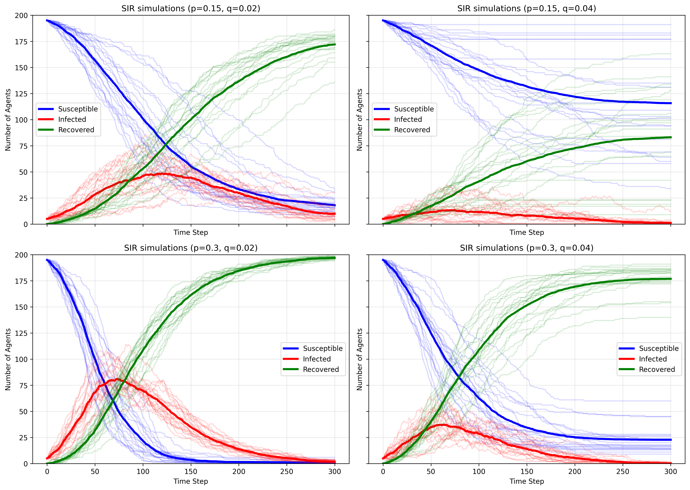
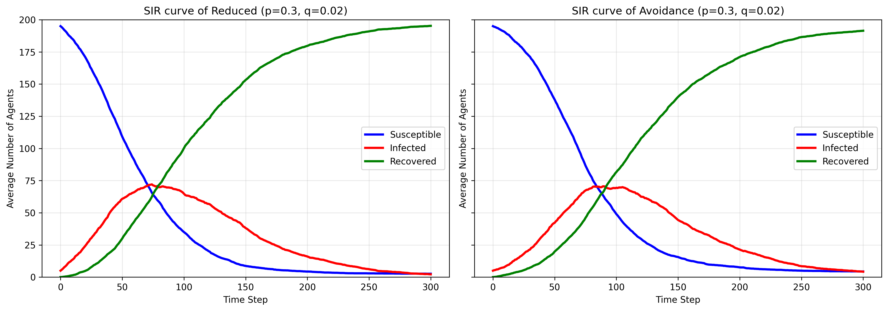
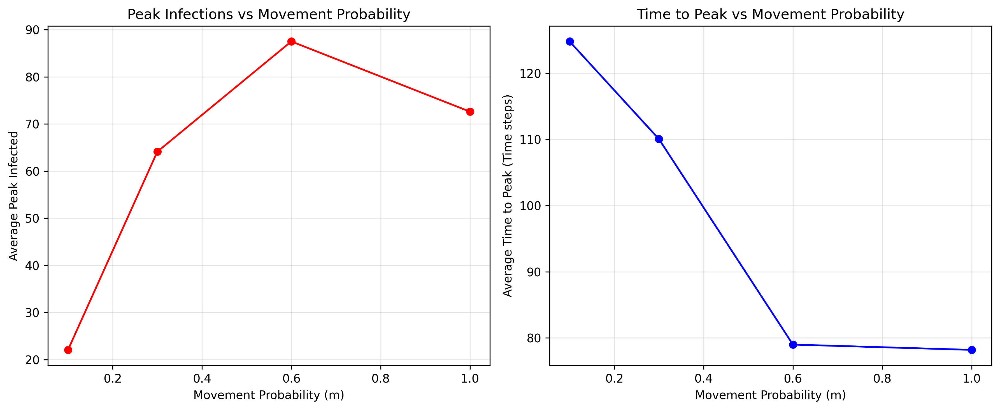
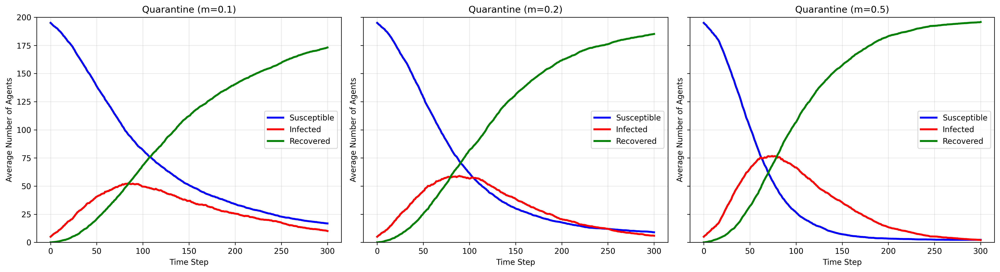
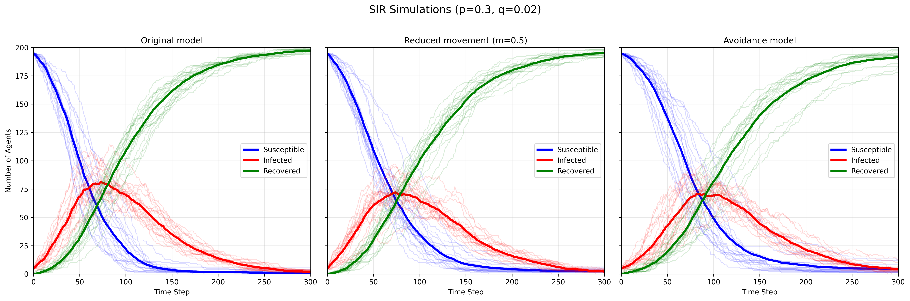

## **HW 2: Agent-Based Modeling of Pandemic Spread**
Name: Rongjia (Jasmine) Zhou

Email: rzhou73@emory.edu

Question number: Homework 2

### **Results/answers to the discussion items**
#### Analyze how p and q affect the infection peak, the time to the peak, and the total number of agents ever infected. How much do individual runs differ from the average? In how many runs does the outbreak die out early?

**SIR simulation results — 20 runs per parameter combination**

| p | q | Average peak infected | Average time to peak | Average ever infected by step 300 | Early die-out runs | Mean SIR SD |
|---:|---:|---:|---:|---:|---:|---:|
| 0.15 | 0.02 | 58.55 | 127.05 | 182.00 | 0 | 15.08 |
| 0.15 | 0.04 | 19.35 | 70.55 | 84.20 | 3 | 22.28 |
| 0.30 | 0.02 | 89.10 | 71.60 | 198.85 | 0 | 7.08 |
| 0.30 | 0.04 | 45.05 | 74.65 | 177.20 | 0 | 12.92 |

- Increasing p increased the average total number of agents ever infected. At q = 0.02, doubling p increased the average peak infected from 59 to 89 agents and total infection from 182 to 199 agents. The average time to reach the peak also reduced from 127 time steps to 72 steps. This trend holds true for doubling p at q = 0.04, where the peak and total infections also increased. The average time to peak, however, increased as p increased for q = 0.04. 
- Meanwhile, increasing q reduced the outbreak severity. At p = 0.15, doubling q reduced the average peak infected from 59 to 19 and total infected from 182  to 84. At p = 0.3, doubling q reduced the peak from 89 to 45 and total infections from 199 to 177. The effect on peak timing is not obvious, given that doubling q reduced time to peak for p = 0.15 but slightly deplayed the time to peak for p = 0.3.
- Based on the mean SIR standard deviations (variation across the entire SIR curves), we can see the individuals runs are fairly consistent and resembles the average. The variation between runs was greatest at p = 0.15 and q = 0.04 (SD = 22.28). The SIR curves were most consistent when infection probability (p) was high and recovery probability (q) was low. 
- Assuming 'early' means after 100 time steps zero infected agents were reached, it only occurred when p = 0.15 and q = 0.04 at 3 of 20 runs (~15%). 

#### Which parameter controls the maximum number of simultaneously infected agents, which determines whether the healthcare system is overwhelmed?

- The maximum number of simultaneously affected agents is determined by infection probability (p), recovery probability (q), and movement probability (m). A high p, low q, and m close to 1 would cause the most severe outbreak. 
- The peak infection count determines whether the healthcare system is overwhelmed because it creates the greatest burden. To truly determine healthcare overload, additioanl information is needed (e.g., the capacity of the hospital).

#### Compare results with and without social distancing.
| Measure | Avg Time to Zero | Runs Reached Zero |
|---|---:|---:|
| Avoidance | 409.15 | 20 |
| Original | 364.75 | 20 |
| Reduced movement | 397.55 | 20 |

- **Peak infections**: With the introduction of social distancing, the peak number of infected agents decreased from 89 to 78.95 (reduced) and 79.10 (avoidance). 

- **Peak timing and duration**: The time to the peak is delayed from 71.60 time steps to 73.85 (reduced) and 92.75 (avoidance). However, the average time until no infected agents remained increased from 364.75 time steps to 397.55 (reduced) and 409.15 (avoidance), suggesting social distancing can cause a longer outbreak despite having a lower peak. 

- **Total number of agents infected**: The total number of infections is slightly reduced from 99.4% to 98.7% (reduced) and 97.8% (avoidance). Distancing primarily changed the outbreak's timing and peak infections rather than the total impact size. 

- **Implications for real-world public health interventions**: During a pandemic, reducing contact through social distancing can reduce peak demand and delay infection peak, thereby alleviating the burden of healthcare systems. However, social distancing alone is insufficient to prevent the spread of the pandemic. 

#### Discuss how stricter or more relaxed distancing affects the epidemic.

| m | Avg Peak Infected | Avg Time to Peak |
|---:|---:|---:|
| 0.1 | 22.05 | 124.80 |
| 0.3 | 64.10 | 110.05 |
| 0.6 | 87.50 | 79.00 |
| 1.0 | 72.60 | 78.20 |

- Stricter social distancing (lower m) delays the average time to peak because it reduces transmission opportunities. It also leads to smaller infection scale and lower average peak infections. Relaxing distancing is generally associated with a faster and larger outbreak, but the increase is not consistent for all m (decreased from 87.5 for m = 0.6 to 72.6 for m = 1.0).

#### Additional analysis: effect of quarantine

| m | Avg Peak Infected | Avg Time to Peak | Avg Total Ever Infected |
|---:|---:|---:|---:|
| 0.1 | 56.45 | 93.05 | 183.20 |
| 0.2 | 65.15 | 90.50 | 191.05 |
| 0.5 | 84.75 | 70.75 | 197.75 |

When m = 0.5, the quarantine measure yielded average peak infection to 84.75, which is higher compared to reduced movement (78.95) and avoidance (79.10). The average time to peak is the shortest among the three (70.75 steps). The average total ever infected did not change much. These results suggest that, under the tested conditions, restricting only infected agents’ movement was less effective at lowering and delaying the infection peak than the other two measures. One possible explanation is that susceptible agents continued moving and could still encounter infected agents, even when those infected agents stayed in place. Partial quarantine alone provided limited control of the outbreak in this model.

#### Overall summary figure (most important figure for slide)
The following figure summarizes the individual runs and average SIR curve of original, reduced movement, and avoidance model.

| Model | Mean individual peak height (agents) | Mean individual time to peak (steps) | Average curve peak height (agents) | Average curve time to peak (steps) |
|---|---:|---:|---:|---:|
| Original | 89.10 | 71.60 | 81.05 | 73 |
| Reduced movement | 78.95 | 73.85 | 72.05 | 74 |
| Avoidance | 79.10 | 92.75 | 70.55 | 90 |

### **Discussion (Hypothesis revisited)**
My hypothesis is largely supported by the experiments, although there are some minor deviations. 

- i) The height of the infection peak is lowered and the timing of the infection peak is delayed with reduced movement. At m = 0.5, the average peak decreased from 89.10 to 78.95, while the average time to peak increased from 71.60 to 73.85 steps. At m = 0.1, the average peak was 22.05 at step 124.80. However, less movement does not consistently lower peaks. m = 0.6 produced higher average peak than m = 1.0, which makes my initial hypothesis partially supported. 

- ii) Individual runs varying slightly are partly supported. The variation between individual runs is correct, but some differences existed. The average does not always exactly match individual runs. 

- iii) The average agent-based curves broadly resembles the SIR curves. Infection generally rose and then declined, while recovered counts increased. However, the susceptible population decreased or remained constant instead of slightly rising at later time points. 

### **AI statement**
Chat-GPT was used to complete this homework. The full chat is available at: https://chatgpt.com/share/6ad13a30-b404-83e9-9729-821beb72081b

### **Instructions to run the code**
Install relevant dependencies through: python3 -m pip install -r requirements.txt

numpy==2.2.6
pandas==2.3.2
matplotlib==3.10.0
notebook==7.6.2